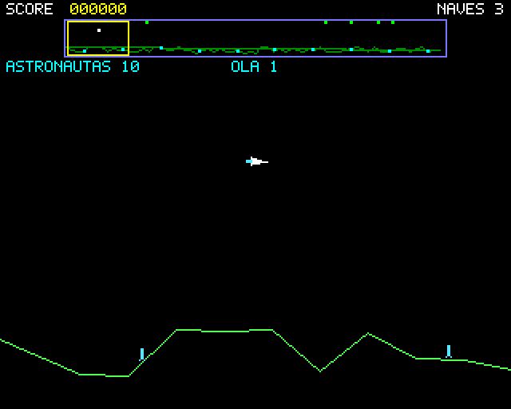

# Tether

A side-scrolling arcade shooter in Python (pygame-ce), built on an
Entity-Component-System architecture. You patrol a small wrap-around planet and keep
its astronauts from being carried off by alien abductors.



Inspired by Williams Electronics' *Defender* (1981): the wrap-around world, the
long-range radar and the abduct-and-rescue loop come from there. The code, the
pixel art (generated by the scripts in `tools/`) and the bitmap font are my own.

I started it to prepare for a game development course, and kept going when the course
never asked for it. The goal was to learn how a game built on ECS holds together, from
the game loop to the radar.

## Run it

```bash
pip install -r requirements.txt
python main.py
```

The [esper](https://github.com/benmoran56/esper) ECS library (v2.5, MIT) is vendored in
`esper/`, so `pygame-ce` is the only runtime dependency.

## Controls

| Action | Key |
|---|---|
| Move | Arrow keys or WASD |
| Fire | Space (or left click) |
| Pause | P |
| Back to menu | Esc |
| Show hitboxes | F1 |
| Extra life (cheat) | F2 |
| Clear the wave (cheat) | F3 |

Every binding lives in `assets/cfg/input.json`.

## How it plays

Abductors drop from the sky, pick an astronaut on the surface and lift it toward
the top of the screen. If they make it, the astronaut is gone. Shoot the abductor on the
way up and the astronaut falls; catch it with your ship and set it back on the ground
for 500 points. Your laser also kills astronauts, so every shot has a cost.

The radar strip at the top shows the whole planet: the world is 1920 px wide (six
screens) and wraps around like a cylinder.

## What's in it

- **A cylindrical world.** Everything lives in world coordinates, and only the renderer
  converts to the screen. `src/engine/world_math.py` holds the three operations that the
  wrap needs (`wrap_x`, `signed_delta_x`, `world_to_screen_x`), and collisions work
  across the seam where the world joins.
- **Strict ECS.** Components only hold data, and systems are plain functions that query
  the world. Each scene (menu, level, game over) owns its own ECS world, so switching
  scenes never leaves stray entities behind.
- **State machines as components.** The ship, the abductors (DESCEND → SEARCH → ABDUCT)
  and the astronauts (WALK → ABDUCTED → FALLING → CARRIED) each have a state component
  and a system that drives it.
- **Data-driven.** 11 JSON files in `assets/cfg/` hold every tunable number: speeds,
  waves, scoring, HUD layout, key bindings. Balancing the game never touches code.
- **Command pattern for input.** Scenes receive action names (`PLAYER_FIRE`), never keys.
- **Service Locator for assets.** Textures, sounds and fonts load once, up front; no
  system opens a file on its own.
- **A 5×7 bitmap font.** At 320×256 a vector font turns into a smudge, so
  `tools/make_pixel_font.py` draws the glyphs pixel by pixel and `FontService` tints them.
- **Browser-ready loop.** `main.py` runs an async game loop so `pygbag` can export it to
  the web.

The full breakdown (components, systems and the order they run in each frame) is in
[docs/ARQUITECTURA.md](docs/ARQUITECTURA.md) (in Spanish).

## Layout

```
main.py                         async entry point (pygbag-compatible)
assets/cfg/                     all game configuration, as JSON
assets/img/ assets/fnt/         sprites and bitmap font (generated by tools/)
tools/                          sprite and font generators
src/engine/game_engine.py       game loop and scene manager
src/engine/scenes/              Scene, MenuScene, PlayScene, GameOverScene
src/engine/service/             texture, sound and font services
src/engine/world_math.py        cylindrical world math
src/engine/collision.py         AABB collision with horizontal wrap
src/create/prefab_creator.py    entity factory
src/ecs/components/             components (data only)
src/ecs/systems/                systems (logic only)
```

## Status

Playable end to end: menu, waves, game over, radar, HUD, lives with invulnerability
frames, explosions and debug views. The sprites are still the generated placeholders and
there is no sound yet. What comes next is in [docs/PLAN.md](docs/PLAN.md).

## Build

```bash
pygbag --build .        # web build in build/web/
pyinstaller --onefile --add-data "assets:assets" --add-data "esper:esper" main.py
```

On Windows, PyInstaller separates `--add-data` paths with `;` instead of `:`.
